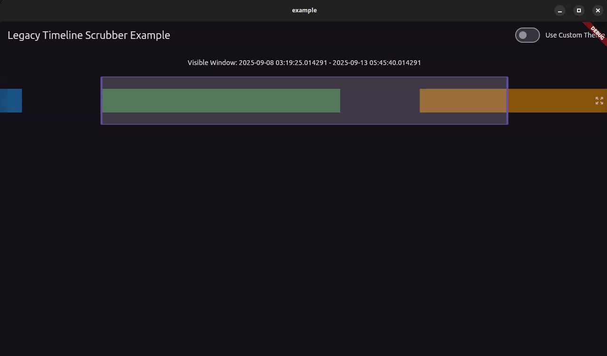

# Legacy Timeline Scrubber

[](https://pub.dev/packages/legacy_timeline_scrubber)

[](https://barneysspeedshop.github.io/legacy_timeline_scrubber/)
[](https://opensource.org/licenses/MIT)

A Flutter widget that provides a timeline scrubber for a Gantt chart. It allows you to visualize tasks and navigate through a timeline.

---

## About the Name

The name `legacy_timeline_scrubber` is a tribute to the package's author, Patrick Legacy. It does not imply that the package is outdated or unmaintained. In fact, it is a modern, actively developed, and highly capable solution for building production-ready Flutter applications.

---



---

## Features

*   Display tasks on a timeline.
*   Scrub through the timeline to change the visible date range.
*   Customize the appearance of the scrubber and tasks.
*   Zoom in and out of the timeline.

## Getting started

To use this package, add `legacy_timeline_scrubber` as a dependency in your `pubspec.yaml` file.

```yaml
dependencies:
  legacy_timeline_scrubber: ^4.0.0
  material_ui: ^1.11.1
```

## Usage

Here is a simple example of how to use the `LegacyGanttTimelineScrubber` widget:

```dart
import 'package:material_ui/material_ui.dart';
import 'package:legacy_timeline_scrubber/legacy_timeline_scrubber.dart';
import 'package:legacy_timeline_scrubber/src/models/legacy_gantt_task.dart';

class MyTimeline extends StatefulWidget {
  @override
  _MyTimelineState createState() => _MyTimelineState();
}

class _MyTimelineState extends State<MyTimeline> {
  late DateTime totalStartDate;
  late DateTime totalEndDate;
  late DateTime visibleStartDate;
  late DateTime visibleEndDate;
  final List<LegacyGanttTask> tasks = [];

  @override
  void initState() {
    super.initState();
    final now = DateTime.now();
    totalStartDate = now.subtract(const Duration(days: 10));
    totalEndDate = now.add(const Duration(days: 10));
    visibleStartDate = now.subtract(const Duration(days: 2));
    visibleEndDate = now.add(const Duration(days: 2));

    tasks.addAll([
      LegacyGanttTask(
        id: '1',
        rowId: 'row1',
        start: now.subtract(const Duration(days: 5)),
        end: now.subtract(const Duration(days: 3)),
        name: 'Task 1',
      ),
    ]);
  }

  void onWindowChanged(DateTime start, DateTime end, ScrubberHandle handle) {
    setState(() {
      visibleStartDate = start;
      visibleEndDate = end;
    });
    debugPrint('Window changed via ${handle.name}');
  }

  @override
  Widget build(BuildContext context) {
    return SizedBox(
      height: 100,
      child: LegacyGanttTimelineScrubber(
        totalStartDate: totalStartDate,
        totalEndDate: totalEndDate,
        visibleStartDate: visibleStartDate,
        visibleEndDate: visibleEndDate,
        onWindowChanged: onWindowChanged,
        tasks: tasks,
      ),
    );
  }
}
```

The onWindowChanged callback provides a `ScrubberHandle` enum that indicates which part of the scrubber was interacted with to cause the change. It has the following values:

* `ScrubberHandle.left`: The left handle of the scrubber window was dragged.
* `ScrubberHandle.right`: The right handle of the scrubber window was dragged.
* `ScrubberHandle.scrub`: The scrubber has translated the viewport horizontally (scrolling).
* `ScrubberHandle.programmatic`: The change was not caused by a direct handle interaction (e.g., clicking the reset zoom button).

This allows you to implement different logic based on how the user interacts with the timeline scrubber.

```dart
void onWindowChanged(DateTime start, DateTime end, ScrubberHandle handle) {
  if (handle == ScrubberHandle.window) {
    // User panned the visible window
  }
  // ... your logic here
}
```

## Material UI migration

Version 4.0.0 is a breaking release for Flutter 3.47 and later. It requires Dart 3.13 or newer and uses the official `material_ui: ^1.11.1` package for Material widgets and theme types. Update application imports from `package:flutter/material.dart` to `package:material_ui/material_ui.dart` before using this package. The public `LegacyGanttTheme.fromTheme` API now accepts `material_ui`'s `ThemeData` type.

## Example Project

This package includes an example project that demonstrates the features of the `LegacyGanttTimelineScrubber`.

To run the example project:

1.  Clone the repository.
2.  Navigate to the `example` directory:

    ```bash
    cd example
    ```

3.  Get the dependencies:

    ```bash
    flutter pub get
    ```

4.  Run the app:

    ```bash
    flutter run
    ```

## Additional information

This package is currently under development. Contributions are welcome. Please file any issues or feature requests on the GitHub repository.
